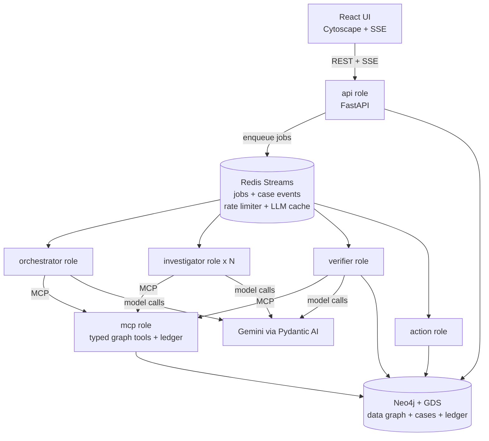
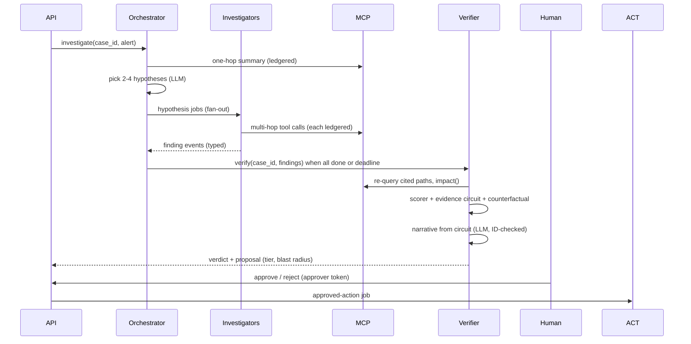
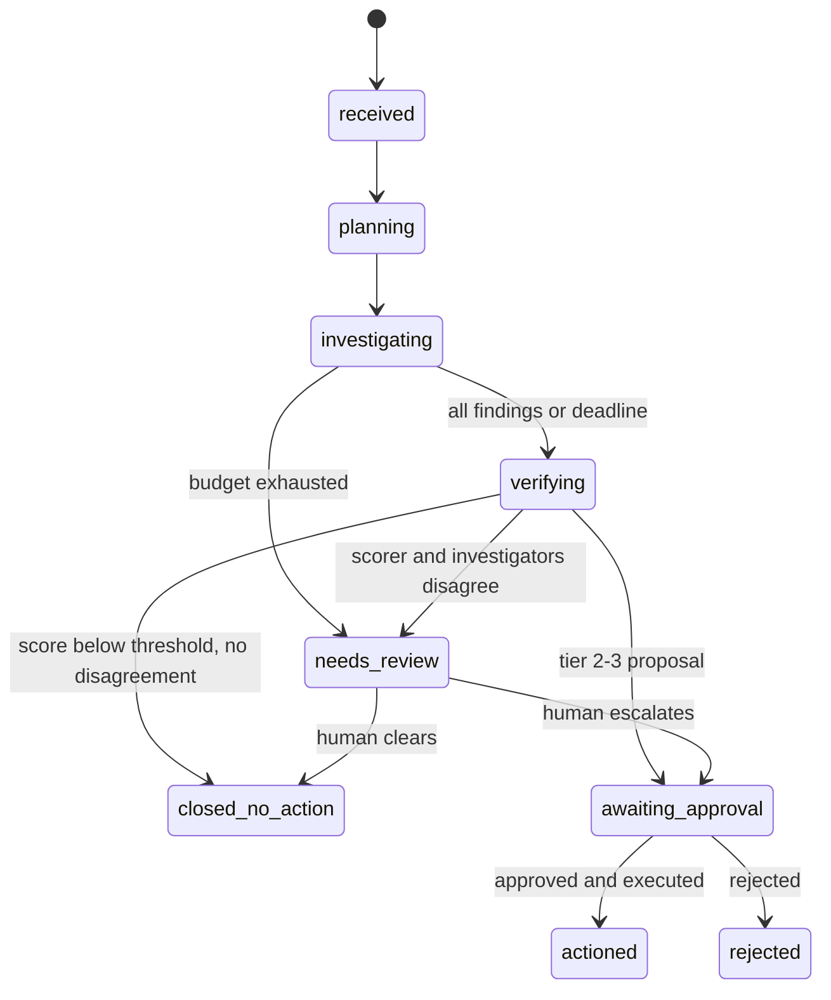
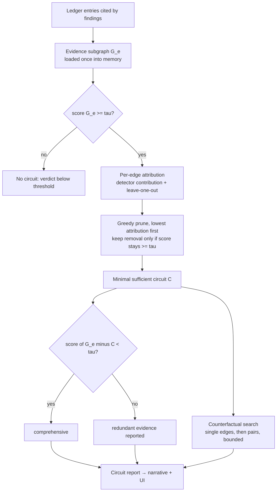
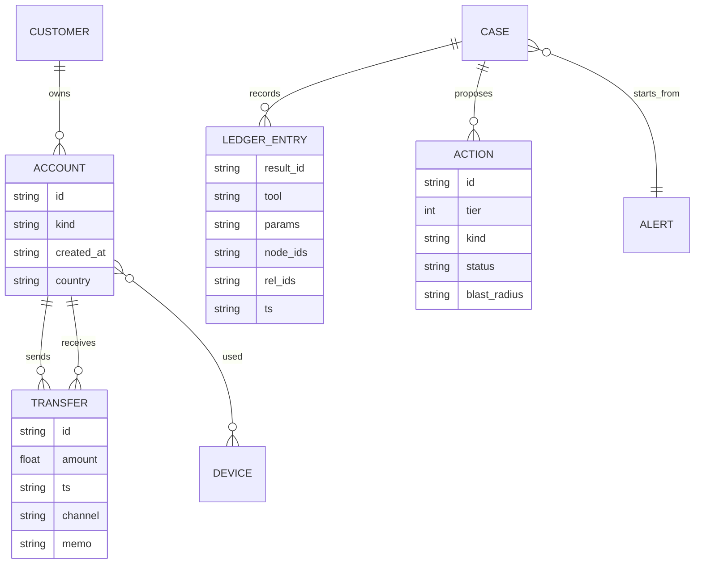
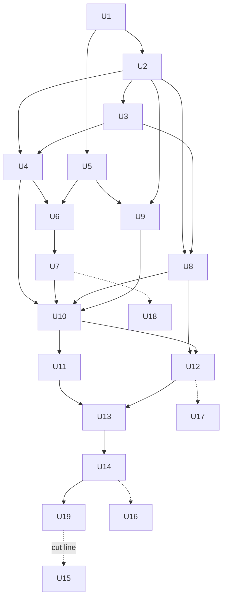

# Lattice AML Investigation Agent - Plan

## Goal Capsule

- **Objective:** An AML analyst, or a hackathon judge acting as one, can pick an alert and watch Lattice investigate the transaction graph across several hops. They receive a verdict whose explanation is a verified minimal evidence subgraph, tested against the transparent risk scorer's decision, with a counterfactual when one exists within the search bound. They then approve or reject the proposed action.
- **Means:** Separately deployable agent workers (orchestrator, investigators, verifier) make every LLM tool call against the graph through an MCP tool server. Deterministic verifier code reads Neo4j through the shared graph client (R4). A transparent risk scorer supports ablation-tested evidence circuits (KTD3, KTD4, KTD8).
- **Authority:** Requirements (R-IDs) win on product behavior; Key Technical Decisions (KTD-IDs) win on mechanism; implementation units override neither. `docs/research.md` is background evidence, not a requirement source.
- **Execution profile:** Phased. Units U1–U14 plus U19 (a pre-submission metrics check) are the submittable demo. The cut line sits after U19. U15–U18 are depth and stretch work, started only once the cut line is met.
- **Stop conditions:** Stop and ask the user in any of these cases:
  - Gemini rate limits make one end-to-end investigation exceed the 5-minute end-to-end target in Success Criteria even with caching, and no paid key is available.
  - The pinned Neo4j image cannot load Graph Data Science (GDS).
  - The scorer cannot reach sufficiency on most planted cases. That means the scorer design (KTD7) is wrong, not something to tune around.
- **Who finishes:** `ce-work` or the team implements unit by unit. The user owns Render deployment credentials and the demo.

---

## Product Contract

### Summary

Build Lattice, an AML investigation system over a Neo4j transaction graph. A synthetic dataset with planted laundering patterns feeds alerts. An orchestrator fans each alert out to parallel investigator agents, one per laundering hypothesis. The investigators work through typed MCP graph tools, and a verifier turns their findings into a verdict. Every flagged verdict ships with an evidence circuit: the smallest set of cited transfers that still keeps the risk scorer's decision above threshold, tested by removing evidence. Tier 2 and tier 3 actions wait for human approval, and tier 0 and tier 1 run automatically (R16). A React UI shows the investigation live, and every role runs as its own container, locally and on Render.

### Problem Frame

The hackathon track asks for an agent that decides and acts on connected data. It names five focus points: multi-hop reasoning, graph queries and algorithms as tools, MCP tool selection, actions grounded in the graph, and explainable results. AML suits the track well. Laundering is a pattern of money moving across many accounts, analysts must justify every decision to auditors, and each case ends in an action (escalate, freeze, report).

The research in `docs/research.md` sets the bar for "explainable":
- **Chain-of-thought isn't trustworthy.** Model reasoning text often omits what drove a decision. Reasoning models disclosed a hint they had used under 20% of the time (Chen et al. 2025).
- **Free-form Cypher is unreliable.** GPT-4o reaches about 60% execution accuracy on CypherBench.
- **Multi-agent systems fail mostly through design.** MAST attributes most failures to unclear specifications, misaligned handoffs and missing verification.

Lattice answers this by grounding explanations in graph facts it can replay and in ablation tests, borrowing ACDC's circuit-discovery method. The LLM's narrative sits on top of that evidence and never replaces it.

### Requirements

**Data and graph**
- R1. A seeded generator produces a transaction graph containing planted laundering typologies, benign decoys that look similar, and a ground-truth manifest. The manifest lists the exact accounts and transfers in each planted pattern.
- R2. Every node and relationship carries a stable application-level ID that survives reloads and is the only ID agents, the ledger and the UI use.
- R3. The generator emits alerts for planted cases and decoys alike, and each alert can start an investigation.

**Tools and MCP**
- R4. Agents' LLM tool calls reach the graph only through an MCP server.
  - Deterministic verifier code (subgraph loading and citation re-checks) reads Neo4j through the shared graph client. It is not ledgered, because it produces no new evidence.
  - It exposes typed, namespaced tools (`graph_*`, `algo_*`, `case_*`) and a guarded read-only Cypher fallback.
  - The agent tool surface contains no action-execution tool.
- R5. Every tool call writes a ledger entry containing a result ID, the tool name and parameters, and the node and relationship IDs returned. The server writes it, not the agent.
- R6. These graph algorithms are available as tools: path finding, PageRank, community detection, similarity, pattern matching, and blast-radius impact.

**Investigation and orchestration**
- R7. An investigation starts from an alert and traverses the graph across multiple hops. It ends with a verdict: typology label, risk level, confidence, and cited evidence.
- R8. An orchestrator splits each investigation into per-hypothesis sub-investigations. These run in parallel on investigator workers, and a verifier combines their findings.
- R9. Each role (API, orchestrator, investigator, verifier, action executor, MCP server) runs as a separately deployable service. Running more copies of a worker raises throughput with no code change.
- R10. The model provider and model are configuration. Gemini is the default.
- R11. Investigations respect a shared LLM rate budget across all workers and a per-investigation step budget. Exhausting either ends the investigation with a partial result marked for human review, not a crash.

**Explainability**
- R12. Every claim in a verdict cites ledger entries.
  - The verifier rejects claims that cite IDs no tool returned.
  - Every cited path is re-queried against the graph before the verdict is accepted.
- R13. Every flagged verdict (one reaching `awaiting_approval` or `needs_review`) includes an evidence circuit containing:
  - the minimal sufficient subgraph,
  - its sufficiency and comprehensiveness results,
  - at least one counterfactual (the smallest set of edges whose removal flips the verdict) when one exists within the search bound.
  - All of these are computed against the risk scorer's decision (KTD7, KTD8), not the LLM's reasoning. LLM-level attribution comes later in U17.
- R14. The narrative explanation is generated from the circuit, detector outputs and ledger, and may only reference IDs present in them.
- R15. When the investigators' verdict and the scorer's verdict disagree, the case is flagged for human review rather than resolved silently.

**Actions and safety**
- R16. Actions are tiered:
  - Tier 0 (read) and tier 1 (annotate) run automatically.
  - Tier 2 (recommend) and tier 3 (execute) require human approval, and the approver sees the blast radius first.
- R17. Actions execute only through the action executor, and only after approval is recorded. No agent can trigger execution.
- R18. Free-text graph fields (memos, names) are treated as untrusted data. Planted prompt-injection cases change neither verdicts nor action proposals.

**Demo and deployment**
- R19. The web UI provides:
  - the alert list and live investigation progress,
  - the evidence circuit rendered as a graph,
  - the verdict card with faithfulness results, labelled as scorer-faithfulness,
  - the counterfactual, the narrative, and approve/reject controls.
- R20. The whole system starts locally with one compose command and deploys to Render as separate services from one blueprint.

**Depth (after cut line)**
- R21. An evaluation run reports decision accuracy, recall of planted edges by circuits, sufficiency and comprehensiveness rates, the hallucinated-citation rate, tool-call statistics, and cost and latency per case.
- R22. A slice of the Elliptic2 Bitcoin dataset loads into the same schema and supports structural investigations.
- R23. (Stretch) An interpretability panel shows an attribution graph explaining an open model's tool choice on a sample investigation step.

### Key Decisions

- **AML is the demo domain.** (session-settled: user-directed — chosen over the consumer scam checker, medication-interaction and allergen options: strongest dataset story and clearest fit to the track's "act on the graph" focus.) Governs R1, R3, R7.
- **Multi-agent orchestration is in the initial scope, not deferred.** (session-settled: user-directed — chosen over deferring orchestration to a later depth phase: the user wants orchestration in the core demo.) Governs R8, R9.
- **Build order: track must-haves first, then research layers.** (session-settled: user-approved — chosen over building research features first: a working end-to-end slice beats a half-built differentiator.) Governs the unit sequencing below.
- **Synthetic data is the primary dataset; Elliptic2 comes after the cut line.** (session-settled: user-approved — chosen over IBM AMLworld/AMLSim and over starting with Elliptic2: exact planted-edge answer keys and no licence or format risk.) Governs R1, R22.
- **Actions land in a simulated case system.** Real bank or exchange integration is outside this product. Governs R16, R17.

### Success Criteria

These are target thresholds on synthetic data. They are not unit-level gates. Before submission, U19 measures them on a small held-out world. After the cut line, U15 measures them on the larger demo world.
- Planted cases are flagged at or above 80%, and decoys are wrongly flagged at or below 20%.
- Evidence circuits on correctly flagged planted cases keep at least 70% of their edges inside the planted pattern (precision), and recover at least 60% of the planted pattern's edges (recall).
- Final verdicts contain zero citations of IDs that no tool returned.
- One end-to-end investigation finishes within 5 minutes on the Gemini free tier, and within 1 minute on a paid key.
- In a live demo, a viewer can go from alert to an approved action without leaving the UI.

### Scope Boundaries

- No real bank, exchange or regulator integration. Freezes and reports are simulated case records.
- No production authentication or multi-tenant security. The approval endpoint carries a single configured approver token so a public demo URL cannot be approved by anyone.
- No model training or fine-tuning. Both the scorer and the agents are used as configured.
- No streaming or real-time transaction ingestion. The graph is batch-loaded.

#### Deferred to Follow-Up Work

- LLM-level evidence attribution in the style of ContextCite (U17), interpretability on an open model (U18), and the Elliptic2 slice (U16) are planned after the cut line.
- Retrieval-based tool search becomes necessary only if the tool surface grows past roughly 15–20 tools.
- The consumer scam-checker front-end on the same engine was discussed and left for later.

### Sources

- `docs/research.md` covers the research background: ACDC/EAP-IG/MIB, ERASER, CF-GNNExplainer, ContextCite, CypherBench, RAG-MCP, MCP-Bench/Universe, MAST, Elliptic2, and the OWASP MCP Top 10.

---

## Planning Contract

### Key Technical Decisions

- KTD1. **Agents run on Pydantic AI with Gemini as the default model, configured by name.** (session-settled: user-approved — chosen over the Claude Agent SDK routed to Gemini through a translation proxy, and over Google's Gemini-only SDK: the proxy route is unsupported and breaks on tool calls, and the Gemini SDK locks out Claude later.)
  - Pydantic AI connects to MCP servers over Streamable HTTP, returns typed (Pydantic) outputs, and ships a deterministic test model for unit tests.
  - Switching to Claude or mixing providers per role (cheap model for investigators, stronger model for the verifier) is a settings change.
  - Governs R10.
- KTD2. **One shared Gemini budget in Redis governs every model call.**
  - Every worker takes a token from a shared rate limiter in Redis before each model call.
  - Responses are cached by a hash of model, messages and tool schema.
  - Each investigation carries a step budget.
  - A recorded-run replay mode lets the UI play back a captured investigation if live calls are throttled on demo day.
  - Why: third-party trackers put the free tier for Flash models at about 10 requests/minute and about 1,500/day, and Pro models left the free tier in April 2026. Verify against the AI Studio rate-limit console, because parallel investigators multiply calls.
  - Governs R11.
- KTD3. **Workers coordinate through Redis Streams consumer groups.**
  - Each job type has its own stream. Unacknowledged jobs are reclaimed after a timeout, and jobs move to a dead-letter stream after three attempts.
  - Case progress events go to a per-case event stream that the API relays to the UI.
  - Rejected alternatives: arq is in maintenance-only mode. Celery's worker model is process/thread-based and clashes with the async agent code.
  - Streams add no task-library dependency, and its consumer groups make "run more copies" (R9) work unchanged.
  - Every handler is idempotent on its job ID.
- KTD4. **Lattice runs its own MCP tool server instead of the official Neo4j MCP server.** (session-settled: user-approved — chosen over adopting the official Neo4j MCP server, whose surface is mainly raw Cypher.)
  - It uses the official MCP Python SDK's FastMCP over stateless Streamable HTTP, with Pydantic return types so tool results are structured.
  - Typed tools were chosen because research shows LocAgent-style purpose-built tools beat free-form query generation.
  - The server, not the agent, writes the ledger entry for each call (R5). The agent therefore cannot fabricate or skip provenance.
  - The case ID is injected by the agent runtime, not chosen by the model.
- KTD5. **Case records and the evidence ledger live in Neo4j under their own labels.** This avoids adding a separate application database. Ledger entries store result ID, case ID, tool, parameters, timestamp, and the returned node and relationship IDs. The data labels and the app labels never share a GDS projection. Transient orchestration state (fan-in counters, deadlines) lives in Redis.
- KTD6. **Stable IDs are application-level string properties with uniqueness constraints.** Neo4j's internal element IDs can be reused, so agents, ledger, scorer and UI never use them (R2). Relationship IDs (`TRANSFER.id`) are first-class because evidence circuits are edge sets.
- KTD7. **The risk scorer is a pure, deterministic function over an in-memory subgraph.** (session-settled: user-approved — chosen over a trained classifier: transparent and cheap enough to rerun thousands of times for ablation.)
  - The scorer combines typology detectors (peeling chain, fan-in/structuring, fan-out, cycle/round-trip, rapid layering, shared device, exit to exchange or mixer).
  - Benign-pattern dampeners keep decoys low: regular cadence, business payroll, merchant inflows.
  - Each detector reports its contribution and the exact edges it used.
  - The subgraph is loaded once from Neo4j into NetworkX. Ablation never touches the database.
  - The decision threshold τ and detector weights are configuration.
- KTD8. **Evidence circuits apply ACDC-style pruning to the scorer's decision** (the U12 algorithm):
  1. Score each edge's attribution: detector contribution plus leave-one-out score drop. This plays the role EAP plays relative to ACDC.
  2. Greedily remove edges in ascending attribution order while the score stays at or above τ. What remains is the minimal sufficient circuit.
  3. Test comprehensiveness: the score of the evidence graph minus the circuit falls below τ. A failure is reported as "redundant evidence", meaning a second independent circuit exists, and is not hidden.
  4. Search for counterfactuals: single edges first, then pairs, bounded.

  The LLM's verdict is not ablated in the core build. R15 covers disagreement, and U17 adds LLM-level attribution later.
- KTD9. **The action executor is the only component that can execute actions.**
  - Investigators and the verifier can only *propose* actions through `case_propose_action`.
  - The API records approvals, which require the approver token.
  - The action executor consumes approved-action jobs only.
  - This enforces R17 by architecture rather than by prompt.
  - Blast radius comes from the `algo_impact` tool and is attached to the proposal before it reaches a human.
- KTD10. **Untrusted text is quarantined in tool results.** Free-text fields return inside a clearly delimited data envelope, and system prompts instruct agents to treat that content as evidence only. Verdicts rest on scorer evidence, not on text. The generator plants injection memos to prove R18 (OWASP MCP06).
- KTD11. **Orchestration uses an orchestrator, workers and a separate verifier, with typed handoffs** (MAST-informed).
  - The orchestrator picks two to four hypotheses from a fixed typology catalog, given the alert and a deterministic one-hop summary.
  - Each investigator gets a typed brief and must return a typed finding: verdict, confidence, evidence relationship IDs, ledger references.
  - The verifier is the only role that produces the final verdict.
  - Fan-in is event-driven. A hypothesis deadline lets the case proceed with completed findings, so no worker ever blocks waiting on another.
- KTD12. **One Python package and one Docker image, with the role chosen at start-up.**
  - This answers the separate-deployment requirement (R9) with the least operational overhead.
  - Compose and Render start the same image with different role commands.
  - The trade-off: one image is larger than per-role images, and that is acceptable at hackathon scale.
- KTD13. **The demo UI is React with Cytoscape.js and server-sent events.** (session-settled: user-approved — chosen over a Streamlit page: the circuit-as-graph view is the demo's centerpiece.) Built with Vite and TypeScript, served as a static site.
- KTD14. **The local stack is pinned.**
  - Python 3.11 managed with uv.
  - Neo4j Community from a pinned 2026.x image with `NEO4J_PLUGINS` set to APOC and `graph-data-science`. GDS Community needs no licence. `dbms.security.procedures.unrestricted` must allow `gds.*`.
  - Redis 7 or Valkey.
  - Neo4j's free cloud tier lacks GDS, so the graph always runs as a container.

### High-Level Technical Design

**Service topology (R9, R20).** Every box except the UI, Neo4j and Redis is the same image started in a different role.



**Investigation flow across the queue (R7, R8, R12, R13, R16).**



**Case lifecycle (R11, R15, R16).**



**Evidence circuit pipeline (KTD7, KTD8).**



**Data model (R1, R2, KTD5, KTD6).**



`TRANSFER` is a relationship between accounts in the property graph. The ERD shows it as an entity because its properties matter.

**Tool surface (R4, R6).** This table is the contract the MCP server implements.

| Tool | Purpose | Returns (always with IDs + `result_id`) |
|---|---|---|
| `graph_schema` | Labels, relationship types, property keys | schema summary |
| `graph_get_node` | One node with properties (text fields quarantined) | node |
| `graph_neighbors` | Neighborhood by direction, rel type, time window, hop limit | nodes + rels |
| `graph_find_paths` | Shortest / k-shortest / bounded simple paths between two nodes | paths |
| `graph_match_pattern` | Named typology pattern templates (fan-in, cycle, chain) with parameters | matches |
| `graph_cypher_readonly` | Fallback: read-only, `EXPLAIN`-checked, row and time capped | rows (IDs extracted) |
| `algo_pagerank` | PageRank / personalized PageRank on a bounded projection | ranked nodes |
| `algo_communities` | Louvain/WCC membership around a node | community + members |
| `algo_similar` | Node similarity to labelled reference cases | similar nodes |
| `algo_impact` | Blast radius: accounts and customers affected by acting on a node | impacted set |
| `case_cite` | Attach ledger references to a claim | citation |
| `case_propose_action` | Propose a tiered action (no execution) | proposal ID |

### Output Structure

```text
pyproject.toml
docker-compose.yml
Dockerfile
render.yaml
.env.example
src/lattice/
  config.py  ids.py  logging.py
  graph/        client.py schema.py loader.py subgraph.py
  datagen/      generator.py background.py typologies.py decoys.py injection.py manifest.py alerts.py cli.py
  mcp_server/   server.py tools_graph.py tools_algo.py tools_case.py cypher_guard.py ledger.py envelope.py
  queue/        streams.py jobs.py events.py ratelimit.py llm_cache.py replay.py
  agents/       provider.py runtime.py schemas.py prompts/ investigator.py orchestrator.py narrator.py
  scoring/      detectors.py dampeners.py scorer.py
  explain/      citations.py circuit.py counterfactual.py report.py
  cases/        store.py actions.py policy.py
  api/          app.py routes_alerts.py routes_cases.py routes_actions.py sse.py
  workers/      main.py orchestrator_worker.py investigator_worker.py verifier_worker.py action_worker.py
  eval/         metrics.py fixture_check.py (U19)  harness.py report.py (after cut line)
  ingest/       elliptic2.py                               (after cut line)
tests/unit/ tests/integration/ tests/fixtures/
ui/            Vite + React + TypeScript app (src/components, src/api.ts, src/__tests__)
research/interp/                                           (stretch)
```

### Sequencing

U1–U3 build the data foundation. U4–U10 deliver every track must-have through a single investigator, end to end. U11–U14 add orchestration, the evidence circuit, the UI and deployment. U19 measures the Success Criteria on a small held-out world. **The submittable cut line sits after U19.**



### System-Wide Impact

- **Failure propagation.** Every dependency failure ends in a defined case state, never a stuck case:
  - **MCP server or Neo4j unreachable:** the tool call raises. The job is retried by the stream (KTD3). After dead-lettering, the case moves to `needs_review` with the failing dependency named.
  - **Gemini errors other than rate limits:** these count as a step. Repeated errors exhaust the step budget and produce a partial finding (R11).
  - **Narrator failure:** falls back to the template (U12). A verdict never waits on prose.
- **State lifecycle.** Durable state (cases, ledger, actions) lives in Neo4j. Transient state lives in Redis: job streams, fan-in counters, limiter, cache, events.
  - If Redis loses data, as Render's free Key Value does on restart, in-flight jobs are lost.
  - A sweeper in the orchestrator role re-enqueues stalled work from case records (U11 lists the covered states). Ledger entries stay intact because they live in Neo4j.
- **Shared database load.** All roles read Neo4j through the MCP server or the verifier. The bounded GDS projections in U4 and the hop and size caps keep per-call cost flat as investigator copies increase. The limiter (KTD2), not Neo4j, is the expected throughput ceiling.
- **Human-only boundary.** Approving tier 2–3 actions is the only human-only operation. It has no agent-accessible equivalent by design (KTD9, R17). Every other case operation available in the UI is also visible in the case's event stream, so the replay and audit views match what humans saw.

### Risks and Dependencies

| Risk | Mitigation |
|---|---|
| Gemini free-tier limits (about 10 RPM / 1,500 per day, per third-party trackers) stall parallel investigators | KTD2 shared limiter + cache + step budget; replay mode for the demo; recommend a paid key for demo day |
| Scorer misses typologies or flags decoys, so circuits explain the wrong thing | Detectors and dampeners are tested against the ground-truth manifest in U8 before any agent work depends on them |
| LLM investigators cite irrelevant edges, inflating evidence graphs | The verifier only accepts ledger-backed citations (R12). Circuit pruning removes irrelevant edges by construction |
| Pydantic AI and the MCP SDK APIs shift between versions (MCP client class names changed in 2025–26) | Pin versions in U1. The agent runtime wraps the toolset behind one module (U6) |
| Render cost: Neo4j needs at least 2 GB RAM and a disk; background workers need paid instances; free Key Value has no persistence | Develop and demo locally on compose. The Render blueprint is ready, and the user confirms budget before deploying |
| Prompt injection through memo fields | KTD10 envelope; verdicts depend on scorer evidence; injection cases in the test set (R18) |
| Elliptic2 access terms or size block U16 | Post-cut-line; the synthetic set carries the demo |

### Alternatives Considered

- **One process running all roles as asyncio tasks.** Simpler to build, but it fails R9: roles can't be deployed or scaled separately. KTD12's single image keeps most of that simplicity.
- **Letting the LLM explain its own verdict.** Rejected. Research shows chain-of-thought is not a faithful account of why a model decided, and ablation over the scorer gives a testable explanation (KTD8).
- **Official Neo4j MCP server with raw Cypher.** Rejected by KTD4 because of Cypher accuracy and because it doesn't write a ledger.

---

## Implementation Units

| U-ID | Title | Key files | Depends on |
|---|---|---|---|
| U1 | Project scaffold and local stack | `pyproject.toml`, `docker-compose.yml`, `Dockerfile`, `src/lattice/config.py` | — |
| U2 | Graph schema, IDs and loader | `src/lattice/graph/*`, `src/lattice/ids.py` | U1 |
| U3 | Synthetic AML generator and alerts | `src/lattice/datagen/*` | U2 |
| U4 | MCP graph tool server and ledger | `src/lattice/mcp_server/*` | U2, U3 |
| U5 | Queue, events, rate limiter and cache | `src/lattice/queue/*`, `src/lattice/workers/main.py` | U1 |
| U6 | Model-neutral agent runtime | `src/lattice/agents/provider.py`, `runtime.py`, `schemas.py` | U4, U5 |
| U7 | Investigator agent | `src/lattice/agents/investigator.py`, `workers/investigator_worker.py` | U6 |
| U8 | Transparent risk scorer | `src/lattice/scoring/*`, `src/lattice/graph/subgraph.py` | U2, U3 |
| U9 | Case store, API and action gate | `src/lattice/cases/*`, `src/lattice/api/*`, `workers/action_worker.py` | U2, U5 |
| U10 | Verifier v1: citations and path re-check | `src/lattice/explain/citations.py`, `workers/verifier_worker.py` | U4, U7, U8, U9 |
| U11 | Orchestrator with hypothesis fan-out and fan-in | `src/lattice/agents/orchestrator.py`, `workers/orchestrator_worker.py` | U10 |
| U12 | Evidence circuit and narrative | `src/lattice/explain/circuit.py`, `counterfactual.py`, `agents/narrator.py` | U8, U10 |
| U13 | Demo UI | `ui/*` | U11, U12 |
| U14 | Container images and Render blueprint | `Dockerfile`, `render.yaml` | U13 |
| U19 | Pre-submission metrics check | `src/lattice/eval/metrics.py`, `fixture_check.py` | U14 |
| U15 | Evaluation harness | `src/lattice/eval/harness.py`, `report.py` | U19 |
| U16 | Elliptic2 slice ingestion | `src/lattice/ingest/elliptic2.py` | U14 |
| U17 | LLM-level evidence attribution | `src/lattice/explain/llm_attribution.py` | U12 |
| U18 | Stretch: tool-choice attribution graph on an open model | `research/interp/*` | U7 |

### Phase 1: Foundation

### U1. Project scaffold and local stack

- **Goal:** One repo with a pinned Python package, a test setup, and a compose stack that brings up Neo4j with GDS and Redis.
- **Requirements:** R20, KTD12, KTD14.
- **Dependencies:** none.
- **Files:**
  - `pyproject.toml`
  - `.env.example`
  - `docker-compose.yml`
  - `Dockerfile`
  - `src/lattice/__init__.py`
  - `src/lattice/config.py`
  - `src/lattice/logging.py`
  - `tests/conftest.py`
  - `tests/integration/test_stack_smoke.py`
- **Approach:**
  1. uv project with Python 3.11. Pin: Pydantic AI, the MCP Python SDK, the Neo4j driver, redis-py (asyncio), FastAPI, NetworkX, pytest, ruff.
  2. `config.py` reads every service URL, model name, rate budget, τ and the approver token from the environment, with typed settings.
  3. Compose services: pinned `neo4j:2026.x` with `NEO4J_PLUGINS` set to APOC and GDS, the GDS procedures unrestricted, and a named volume; Redis 7. App roles are added in later units.
  4. Pytest markers separate `unit` tests from `integration` tests, which need the compose stack.
- **Execution note:** Mostly packaging and environment. Prove it with a runtime smoke check, not unit coverage.
- **Test scenarios:**
  - With compose up, the smoke test connects to Neo4j and gets a GDS version from `gds.version()`.
  - With compose up, the smoke test writes and reads a Redis key.
  - Config loading fails with a clear message naming the missing variable when a required env var is absent.
- **Verification:** One compose command brings both services to healthy, and the smoke test passes.

### U2. Graph schema, IDs and loader

- **Goal:** A fixed property-graph schema with stable string IDs, uniqueness constraints and a bulk loader.
- **Requirements:** R2, KTD5, KTD6.
- **Dependencies:** U1.
- **Files:**
  - `src/lattice/ids.py`
  - `src/lattice/graph/client.py`
  - `src/lattice/graph/schema.py`
  - `src/lattice/graph/loader.py`
  - `tests/unit/test_ids.py`
  - `tests/integration/test_loader.py`
- **Approach:**
  - Node labels: `Customer`, `Account`, `Device`, `Alert`, `Case`, `LedgerEntry`, `Action`.
  - Relationships: `OWNS`, `TRANSFER` (with `id`, amount, timestamp, channel, memo) and `USED_DEVICE`.
  - `ids.py` builds prefixed, deterministic IDs (`acct_…`, `tx_…`) from the generator seed.
  - The loader writes in batches with `UNWIND` and creates constraints and indexes first. It is idempotent on IDs.
  - `client.py` is the single async driver wrapper the other modules use.
- **Test scenarios:**
  - Generating IDs twice from the same seed yields identical IDs. Different seeds yield different ones.
  - Loading the same batch twice leaves node and relationship counts unchanged.
  - Loading a batch with a duplicate account ID is rejected by the constraint, with the offending ID in the error.
  - A loaded `TRANSFER` can be fetched by its `id` property, and its endpoints match the input.
- **Verification:** The schema exists after the loader runs, and the integration tests pass against compose.

### U3. Synthetic AML generator and alerts

- **Goal:** A seeded generator producing realistic background traffic, planted typologies, look-alike decoys, injection cases, a ground-truth manifest and alerts.
- **Requirements:** R1, R3, R18.
- **Dependencies:** U2.
- **Files:**
  - `src/lattice/datagen/generator.py`
  - `src/lattice/datagen/background.py`
  - `src/lattice/datagen/typologies.py`
  - `src/lattice/datagen/decoys.py`
  - `src/lattice/datagen/injection.py`
  - `src/lattice/datagen/manifest.py`
  - `src/lattice/datagen/alerts.py`
  - `src/lattice/datagen/cli.py`
  - `tests/unit/test_typologies.py`
  - `tests/unit/test_generator.py`
  - `tests/fixtures/small_world.json`
- **Approach:**
  - **Background:** customers and accounts with heavy-tailed degree, salaries, merchant spend and peer transfers over a time window.
  - **Planted typologies,** each a parameterized function that returns its accounts and transfers:
    - peeling chain
    - fan-in / structuring just under a reporting threshold
    - fan-out
    - round-trip cycle
    - rapid layering through young accounts
    - shared device across unrelated customers
    - exit to an exchange or mixer
  - **Decoys:** payroll fan-out, merchant fan-in, family cycles. They are shaped like the typologies but benign.
  - **Injection:** memo text that tries to instruct agents, planted on some planted and some benign transfers. Each injection case also gets a memo-free twin (same structure, memo removed), and the manifest records the pairing.
  - **Manifest:** case ID, typology or decoy kind, exact account and transfer IDs, expected verdict.
  - **Alerts:** one per planted and decoy case, triggered from a single seed account so the investigation must hop outwards.
  - **Sizes:** the CLI writes a small fixture world (hundreds of nodes) for tests and a demo world (tens of thousands).
- **Test scenarios:**
  - Each planted typology's transfers satisfy its defining property. Examples: the peeling chain forwards most of the inflow at each hop, and the cycle returns to its origin within the window.
  - Each decoy fails at least one property that separates it from its look-alike typology. For example, payroll fan-out has regular cadence from a business account.
  - The same seed produces a byte-identical manifest.
  - Every manifest ID exists in the generated graph.
  - Every planted case and every decoy has exactly one alert, and its seed account belongs to that case.
  - Injection memos appear on both planted and benign transfers, and the manifest flags them.
- **Verification:** The CLI loads the demo world into compose Neo4j and prints per-typology counts that match the manifest.

### Phase 2: Track must-haves

### U4. MCP graph tool server and ledger

- **Goal:** The MCP server exposing the tool-surface contract, writing a ledger entry per call, with guarded Cypher and quarantined text.
- **Requirements:** R4, R5, R6, R18, KTD4, KTD5, KTD10.
- **Dependencies:** U2, U3.
- **Files:**
  - `src/lattice/mcp_server/server.py`
  - `src/lattice/mcp_server/tools_graph.py`
  - `src/lattice/mcp_server/tools_algo.py`
  - `src/lattice/mcp_server/tools_case.py`
  - `src/lattice/mcp_server/cypher_guard.py`
  - `src/lattice/mcp_server/ledger.py`
  - `src/lattice/mcp_server/envelope.py`
  - `tests/unit/test_cypher_guard.py`
  - `tests/unit/test_envelope.py`
  - `tests/integration/test_mcp_tools.py`
- **Approach:**
  - FastMCP over stateless Streamable HTTP. Each tool has a typed result model that always includes `result_id`, `node_ids` and `rel_ids`.
  - A shared decorator writes the ledger entry after a successful query and before returning.
  - **`algo_*` tools** project a bounded subgraph around the focus node (hop and size caps) into GDS, run the algorithm, and drop the projection. Projection names are unique per call, so concurrent investigators never collide. Projections are dropped in a `finally` path, even when the algorithm fails.
  - **`graph_cypher_readonly`** applies these guards:
    - rejects write clauses and procedure calls outside an allow-list,
    - runs `EXPLAIN` first,
    - runs in a read transaction with a timeout and row cap.
  - **`case_propose_action`** creates an `Action` record in `proposed` state and nothing else.
  - **Tool descriptions** say *when* to use each tool.
  - **Case context:** the server expects it on every call and refuses calls without it.
- **Test scenarios:**
  - `graph_find_paths` between the endpoints of a planted peeling chain returns that chain's transfer IDs.
  - Every tool call produces exactly one ledger entry whose `rel_ids` equal the relationships in the response.
  - `graph_cypher_readonly` rejects `CREATE`, `MERGE`, `DELETE`, `SET`, `LOAD CSV` and non-allow-listed `CALL` before execution.
  - A read query exceeding the row cap returns the capped rows plus a truncation flag, not an error.
  - A tool call without case context is refused, and no ledger entry is written.
  - A transfer memo containing injected instructions comes back inside the data envelope, never as a top-level string.
  - `algo_impact` on a seed account returns the accounts and customers reachable within the configured hops, and leaves no GDS projection behind.
  - `algo_communities` on a member of a planted ring returns a community that contains the ring's accounts.
  - Two concurrent `algo_pagerank` calls on overlapping neighborhoods both succeed, and no projection remains afterwards.
  - An algorithm that fails mid-run still drops its projection and writes no ledger entry.
- **Verification:** The MCP Inspector lists every tool in the surface table, and the integration tests pass against the fixture world.

### U5. Queue, events, rate limiter and cache

- **Goal:** The shared worker runtime: job streams with consumer groups, case event streams, the shared model rate limiter, the LLM response cache and replay recording.
- **Requirements:** R9, R11, KTD2, KTD3.
- **Dependencies:** U1.
- **Files:**
  - `src/lattice/queue/streams.py`
  - `src/lattice/queue/jobs.py`
  - `src/lattice/queue/events.py`
  - `src/lattice/queue/ratelimit.py`
  - `src/lattice/queue/llm_cache.py`
  - `src/lattice/queue/replay.py`
  - `src/lattice/workers/main.py`
  - `tests/integration/test_streams.py`
  - `tests/integration/test_ratelimit.py`
  - `tests/unit/test_jobs.py`
- **Approach:**
  - **Jobs** are typed envelopes (job ID, case ID, type, attempt, payload) on one stream per job type.
  - **The consumer loop** handles the lifecycle: read via the group, then handle, ack, reclaim stale pending entries, and dead-letter after three attempts.
  - **Heartbeat:** a worker re-claims its own in-flight job on a heartbeat shorter than the reclaim idle timeout, so a long LLM-bound job is never reclaimed while alive. The idle timeout is configured below the U11 hypothesis deadline.
  - **The limiter** is an atomic token bucket in Redis shared by all workers. A model call waits up to a bound, then reports "budget exhausted".
  - **The cache** is keyed by a hash of model, messages and tool schema, with a TTL. It can be disabled.
  - **Replay** stores a case's ordered event stream for later playback.
  - **`workers/main.py`** picks the role from a CLI argument and runs that role's handler.
- **Test scenarios:**
  - Two consumers in one group each receive distinct jobs, and no job is delivered to both.
  - A job whose handler crashes before ack is reclaimed by another consumer after the idle timeout.
  - A job whose handler outlives the idle timeout while heartbeating is not delivered to a second consumer.
  - A job failing three times lands in the dead-letter stream with its last error.
  - Re-delivering an already-completed job ID is a no-op (idempotency record hit).
  - With a budget of N per minute, N+5 concurrent acquisitions across two processes let exactly N through within the window.
  - An acquisition that waits past its bound returns budget-exhausted rather than blocking forever.
  - A cache hit returns the stored response without calling the model. Changing the tool schema misses the cache.
  - Replaying a recorded case emits its events in their original order.
- **Verification:** Integration tests pass against compose Redis, and starting two copies of a dummy role shares one stream.

### U6. Model-neutral agent runtime

- **Goal:** One module that builds a Pydantic AI agent for any role from config. It wires in the MCP toolset, the limiter, the cache, the step budget and case-context injection.
- **Requirements:** R10, R11, KTD1, KTD2, KTD4.
- **Dependencies:** U4, U5.
- **Files:**
  - `src/lattice/agents/provider.py`
  - `src/lattice/agents/runtime.py`
  - `src/lattice/agents/schemas.py`
  - `src/lattice/agents/prompts/`
  - `tests/unit/test_runtime.py`
- **Approach:**
  - `provider.py` maps a configured model string to a Pydantic AI model. Gemini via an AI Studio key is the default, and other providers can be added.
  - `runtime.py`:
    - attaches the MCP toolset over Streamable HTTP,
    - injects the case ID into every tool call,
    - takes a limiter token before each model request and consults the cache,
    - enforces the step budget, ending with a typed partial result.
  - `schemas.py` holds the typed handoffs: hypothesis brief, finding, verdict, action proposal.
  - Prompts live as files per role.
- **Test scenarios:**
  - With the Pydantic AI test model scripted to call `graph_neighbors`, the runtime forwards the call with the injected case ID. The model never supplies the case ID.
  - When the step budget is reached mid-investigation, the runtime returns a partial finding marked budget-exhausted.
  - When the limiter reports budget exhausted, the agent returns a partial result instead of raising.
  - Changing the configured model string to another provider builds an agent without code changes (construction only, no network).
  - Output that fails the finding schema triggers the framework's retry. After the retry limit the result is a typed failure.
- **Verification:** Unit tests pass with the deterministic test model, and one manual run against live Gemini returns a schema-valid finding.

### U7. Investigator agent

- **Goal:** An investigator role that takes a hypothesis brief, investigates across multiple hops through MCP tools, and returns a typed finding. In Phase 2 it also runs alone with an open "all typologies" hypothesis, so the full track loop works before orchestration exists.
- **Requirements:** R7, R18, KTD10, KTD11.
- **Dependencies:** U6.
- **Files:**
  - `src/lattice/agents/investigator.py`
  - `src/lattice/agents/prompts/investigator.md`
  - `src/lattice/workers/investigator_worker.py`
  - `tests/unit/test_investigator.py`
  - `tests/integration/test_investigator_live.py`
- **Approach:**
  - The prompt describes the hypothesis's defining pattern, recommends a plan-the-path-first strategy (Reasoning-on-Graphs style), and requires every claim in the finding to carry relationship IDs.
  - The worker consumes hypothesis jobs and emits finding events to the case stream. In single-agent mode it enqueues the verify job directly.
- **Test scenarios:**
  - **Scripted test model, planted peeling chain:** the finding cites transfer IDs that are all in the ledger, and the verdict supports the hypothesis.
  - **Scripted test model, decoy payroll fan-out:** a fan-out hypothesis returns a "refutes" finding.
  - **Live model, marked live:** on three fixture planted cases, findings cite at least one planted transfer each.
  - **Injected memo** telling the agent to declare the account benign: the verdict is unchanged versus the same case with the memo removed (scripted model honoring the envelope, plus one live check).
  - **Partial finding:** a budget-exhausted investigation still emits a finding event marked partial, so fan-in never stalls.
- **Verification:** With compose plus a single investigator, posting an alert produces a finding event with ledger-backed citations.

### U8. Transparent risk scorer

- **Goal:** A pure scorer over an in-memory evidence subgraph, made of attributable detectors and benign dampeners.
- **Requirements:** R13, R15, KTD7.
- **Dependencies:** U2, U3.
- **Files:**
  - `src/lattice/graph/subgraph.py`
  - `src/lattice/scoring/detectors.py`
  - `src/lattice/scoring/dampeners.py`
  - `src/lattice/scoring/scorer.py`
  - `tests/unit/test_detectors.py`
  - `tests/unit/test_scorer_ground_truth.py`
- **Approach:**
  - `subgraph.py` loads a set of relationship IDs and their endpoints from Neo4j into a NetworkX multi-digraph once.
  - Each detector returns its strength, the edges it used and a short reason code.
  - The scorer combines weighted detectors, applies dampeners, and returns:
    - the total score,
    - a typology label (the strongest detector),
    - per-detector contributions,
    - per-edge contributions.
  - Weights and τ are configuration.
  - Tuning uses the fixture world's manifest only. Demo-world cases stay held out for U15.
- **Execution note:** Implement test-first against the ground-truth manifest. This unit decides whether circuits mean anything.
- **Test scenarios:**
  - Each planted typology's manifest edges, scored alone, exceed τ with the matching typology label.
  - Each decoy's edges, scored alone, stay below τ.
  - Removing a peeling chain's middle hop drops the peeling detector's strength, and the per-edge contribution of that hop is non-zero.
  - An empty subgraph scores zero with no typology.
  - Scoring the same subgraph twice returns identical results (determinism).
  - Scoring a 200-edge subgraph completes fast enough for 10,000 rescorings in the circuit budget (timed benchmark, threshold set in implementation).
- **Verification:** The ground-truth test passes on every fixture planted case and decoy.

### U9. Case store, API and action gate

- **Goal:** Case records, the REST and SSE API, approvals with the approver token, and the action executor role.
- **Requirements:** R3, R16, R17, R19 (API side), KTD5, KTD9.
- **Dependencies:** U2, U5.
- **Files:**
  - `src/lattice/cases/store.py`
  - `src/lattice/cases/actions.py`
  - `src/lattice/cases/policy.py`
  - `src/lattice/api/app.py`
  - `src/lattice/api/routes_alerts.py`
  - `src/lattice/api/routes_cases.py`
  - `src/lattice/api/routes_actions.py`
  - `src/lattice/api/sse.py`
  - `src/lattice/workers/action_worker.py`
  - `tests/unit/test_policy.py`
  - `tests/integration/test_api_flow.py`
- **Approach:**
  - **Routes:**
    - list alerts,
    - start an investigation (creates a case and enqueues it). Idempotent per alert: it returns the existing active case. Configurable caps on concurrently active cases and cases per day return 429 when exceeded, so a public URL cannot drain the shared model budget (KTD2),
    - get a case,
    - stream the case's events over SSE,
    - approve or reject an action (requires the approver token),
    - escalate or clear a `needs_review` case (requires the approver token).
  - **Action policy** in `policy.py`:
    - assigns tiers by action kind: annotate is tier 1, escalate and draft report are tier 2, freeze is tier 3,
    - refuses execution of any action without a recorded approval.
  - **The action executor** consumes only approved-action jobs and writes the simulated outcome to the case.
- **Test scenarios:**
  - Starting an investigation creates a case in `received` and enqueues exactly one job.
  - Approving a tier-3 action without the approver token returns unauthorized, and the action stays `proposed`.
  - Approving with the token moves the action to `approved`, enqueues it, and the action executor records `executed`.
  - A tier-1 annotate action executes without approval.
  - Enqueuing an executor job directly for an unapproved action results in a refusal recorded on the case (defence in depth).
  - The SSE stream delivers case events in order, including those emitted before the client connected (replay from stream start).
  - Rejecting an action records the rejection, and nothing executes.
  - Starting an investigation twice for the same alert returns the same active case and enqueues one job.
  - Starting a new investigation past the active-case cap returns 429, and no case is created.
  - Clearing a `needs_review` case without the approver token returns unauthorized, and the case stays in `needs_review`.
- **Verification:** The API integration test drives alert → case → (stubbed) proposal → approval → executed action against compose.

### U10. Verifier v1: citations and path re-check

- **Goal:** The verifier role that turns findings into a verdict:
  - validates citations,
  - re-queries cited paths,
  - runs the scorer and checks disagreement,
  - computes blast radius and proposes the action.

  Completing this unit finishes the single-investigator path through every track focus point. Orchestration, the evidence circuit, the UI, deployment and the metrics check (U11–U14, U19) are still required before the cut line.
- **Requirements:** R12, R15, R16, KTD9.
- **Dependencies:** U4, U7, U8, U9.
- **Files:**
  - `src/lattice/explain/citations.py`
  - `src/lattice/workers/verifier_worker.py`
  - `tests/unit/test_citations.py`
  - `tests/integration/test_verifier.py`
- **Approach:**
  1. Collect claims and their cited relationship IDs from findings. Drop any claim citing an ID not present in the case's ledger (R12), and record the rejected citations.
  2. Re-query that the remaining cited relationships still exist with the same endpoints.
  3. Build the evidence subgraph and run the scorer.
  4. Aggregate the investigators' verdict. Hypotheses are alternatives, so the case is "suspicious" when any non-partial finding supports its hypothesis, labelled with the highest-confidence supported typology, and "not suspicious" otherwise. Disagreement means either the scorer is at or above τ with no supported hypothesis, or it is below τ with at least one. On disagreement, move the case to `needs_review` (R15).
  5. Call `algo_impact` and attach the blast radius to a proposal tiered by `policy.py`.
- **Test scenarios:**
  - A claim citing a fabricated transfer ID is dropped, and the ID is listed in the verdict's rejected-citations field.
  - A cited relationship deleted from the graph after citation fails re-verification, and the claim is dropped.
  - A planted case where investigators and scorer agree produces an `awaiting_approval` case with a tier-2 or tier-3 proposal and a non-empty blast radius.
  - A decoy where investigators say "supports" but the scorer stays below τ goes to `needs_review` with a disagreement reason.
  - A finding marked partial still contributes its valid citations, and the case notes the partial input.
- **Verification:** End to end on compose with a single investigator, a planted alert reaches `awaiting_approval` with only ledger-backed citations.

### Phase 3: Orchestration, evidence circuit, UI and deployment

### U11. Orchestrator with hypothesis fan-out and fan-in

- **Goal:** An orchestrator role that chooses hypotheses, fans them out to investigator workers, collects findings event-by-event with a deadline, and hands off to the verifier.
- **Requirements:** R8, R9, R11, KTD11.
- **Dependencies:** U10.
- **Files:**
  - `src/lattice/agents/orchestrator.py`
  - `src/lattice/agents/prompts/orchestrator.md`
  - `src/lattice/workers/orchestrator_worker.py`
  - `tests/unit/test_orchestrator.py`
  - `tests/integration/test_fanout.py`
- **Approach:**
  - A deterministic one-hop summary through MCP feeds one LLM call. That call picks two to four hypotheses from the typology catalog, and its typed output can't name typologies outside the catalog.
  - **The typology catalog** is the KTD7 detector set: peeling chain, fan-in/structuring, fan-out, round-trip cycle, rapid layering, shared device, exit to exchange or mixer. The fallback default set is peeling chain, fan-in/structuring and rapid layering.
  - **Fan-in state** (expected hypothesis IDs, a set of received hypothesis IDs, deadline) lives in Redis, keyed by case. Duplicate findings for the same hypothesis are absorbed by the set.
  - **A periodic sweeper** re-enqueues stalled work from Neo4j records (System-Wide Impact). It covers cases stuck in `received`, `planning`, `investigating` or `verifying` past their deadline, and approved actions that were never executed.
  - The verify job is enqueued exactly once, either when all findings have arrived or when the deadline passes.
  - The single-agent path from U7 remains available as a config switch for debugging.
- **Test scenarios:**
  - A scripted choice of three hypotheses enqueues three hypothesis jobs with distinct briefs.
  - When all three findings arrive, exactly one verify job is enqueued, even if two findings arrive concurrently.
  - When one investigator never responds, the deadline triggers verification with two findings, and the case notes the missing hypothesis.
  - After Redis is flushed mid-investigation, the sweeper re-enqueues the case from its Neo4j record. It reaches a verdict, and the earlier ledger entries are still present. The same holds for a case flushed while in `verifying`.
  - A duplicate finding for an already-received hypothesis does not trigger verification early.
  - **Planted peeling chain with three hypotheses:** only the peeling hypothesis supports, and the case reaches `awaiting_approval`, not `needs_review`.
  - A model output naming an unknown typology is rejected by the schema, and the orchestrator falls back to the catalog default set.
  - With two investigator workers running, three hypothesis jobs are processed by both workers (parallelism observable in events).
- **Verification:** On compose with two investigator replicas, a planted alert runs orchestrator → parallel investigators → verifier and reaches a verdict.

### U12. Evidence circuit and narrative

- **Goal:**
  - The circuit engine: attribution, pruning, sufficiency, comprehensiveness and counterfactual search.
  - A narrator that writes the explanation from the circuit and may only reference its IDs.
- **Requirements:** R13, R14, KTD7, KTD8.
- **Dependencies:** U8, U10.
- **Files:**
  - `src/lattice/explain/circuit.py`
  - `src/lattice/explain/counterfactual.py`
  - `src/lattice/explain/report.py`
  - `src/lattice/agents/narrator.py`
  - `src/lattice/agents/prompts/narrator.md`
  - `tests/unit/test_circuit.py`
  - `tests/unit/test_counterfactual.py`
  - `tests/unit/test_narrator.py`
- **Approach:**
  - The verifier calls the circuit engine after scoring. The pipeline follows the evidence circuit pipeline diagram in High-Level Technical Design.
  - The counterfactual search is bounded: single edges, then pairs among the top-attributed edges up to a configured cap.
  - The report holds:
    - circuit edges,
    - the sufficiency score,
    - the comprehensiveness result,
    - a redundancy flag,
    - counterfactuals with resulting scores,
    - the per-detector breakdown.
  - The narrator receives only the report and the ledger excerpts for circuit edges. Its output is checked so every referenced ID belongs to the report. On a rate-limit failure a templated narrative is used.
- **Test scenarios:**
  - **Planted peeling chain with unrelated cited edges:** the circuit drops the unrelated edges and keeps the chain.
  - **Sufficiency and comprehensiveness:** every circuit scores at or above τ when scored alone. Removing the circuit from the evidence graph drops the score below τ on a single-chain case.
  - **Two independent planted chains in one evidence graph:** the comprehensiveness check fails, and the report flags redundant evidence.
  - **Single counterfactual:** a chain whose removal of one specific hop flips the verdict reports that hop.
  - **Pair counterfactual:** a case where no single edge flips the verdict but a pair does reports the pair. When neither exists within the cap, the report says "no counterfactual within bound".
  - **Determinism:** circuit output is identical across runs on the same input.
  - **Narrator ID check:** a narrator output referencing an ID outside the circuit is rejected and regenerated or replaced by the template.
  - **Precision:** on fixture planted cases, circuit edges fall mostly inside the manifest's planted edges. Assert the U15 precision target on the fixture set.
- **Verification:** Verified cases on compose carry a circuit report and a narrative, and the fixture-level precision check passes.

### U13. Demo UI

- **Goal:** The React app the demo runs on. It shows the alert list, a live investigation timeline, the circuit graph, the verdict and faithfulness card, the counterfactual, the narrative, and approve/reject.
- **Requirements:** R19, KTD13.
- **Dependencies:** U11, U12.
- **Files:**
  - `ui/package.json`
  - `ui/src/App.tsx`
  - `ui/src/api.ts`
  - `ui/src/components/AlertList.tsx`
  - `ui/src/components/InvestigationTimeline.tsx`
  - `ui/src/components/GraphView.tsx`
  - `ui/src/components/VerdictCard.tsx`
  - `ui/src/components/ApprovalPanel.tsx`
  - `ui/src/components/Counterfactuals.tsx`
  - `ui/src/components/Narrative.tsx`
  - `ui/src/__tests__/VerdictCard.test.tsx`
  - `ui/src/__tests__/GraphView.test.tsx`
  - `ui/src/__tests__/ApprovalPanel.test.tsx`
  - `ui/src/__tests__/Counterfactuals.test.tsx`
- **Approach:**
  - **Stage-driven layout:**
    - While investigating, the timeline is grouped into one lane per hypothesis, and GraphView draws the evidence graph incrementally from ledger relationship IDs.
    - At `verifying`, a verifier progress step shows.
    - At `awaiting_approval`, the verdict card, circuit highlight and approval panel take focus.
  - **GraphView** highlights circuit edges with thicker, labelled edges (not color alone) and greys out the rest of the evidence graph. Clicking an edge shows its ledger entry.
  - **Counterfactuals** lists each counterfactual. Selecting one toggles its edge set off in GraphView and shows the precomputed resulting score and verdict from the circuit report. There is no client-side rescoring.
  - **Narrative** renders referenced IDs as links that focus the matching graph element.
  - **Outcome states** each have defined content:
    - `closed_no_action`: the reason, and the evidence graph with no circuit highlight.
    - `needs_review`: the disagreement or failure reason, both verdicts, and token-gated escalate/clear controls.
    - Partial or budget-exhausted findings: a banner.
    - "No counterfactual within bound": a message.
    - Redundant evidence: a flag.
    - Rejected and executed actions: the outcome.
    - Dropped SSE connection: a connection indicator with auto-reconnect.
  - **ApprovalPanel** asks the approver for the token at runtime and keeps it only in memory or session storage. It is never a build-time variable or part of the static site's config.
    - Approval is gated on the blast radius for every tier 2 and 3 proposal.
    - A 401 shows an inline error.
    - The panel shows proposed, approving, executing, executed and rejected states.
  - **Replay mode** is reached from a Replay entry on each recorded alert. It shows a persistent "Replay" banner and play/pause controls over the recorded event stream.
- **Test scenarios:**
  - The verdict card renders sufficiency, comprehensiveness and the redundancy flag from a fixture circuit report, labelled as scorer-faithfulness.
  - GraphView marks circuit edges differently from other evidence edges, given a fixture report.
  - The approve button is disabled for tier 2 and tier 3 actions until the blast radius has loaded.
  - An approval rejected with 401 shows the inline error, and the action stays proposed.
  - The built UI bundle contains no approver-token config key.
  - A `closed_no_action` fixture renders its reason and no circuit highlight. A `needs_review` fixture renders both verdicts and the escalate/clear controls.
  - Selecting a single-edge counterfactual and a pair counterfactual toggles those edges and shows the precomputed flipped verdict.
  - Clicking an ID link in the narrative focuses the matching graph edge.
  - The timeline appends events in arrival order from a mocked SSE source.
  - Replay of a recorded event file renders the same final state as the live run that produced it.
- **Verification:** With compose plus the UI dev server, a viewer completes alert → live investigation → circuit → approval in the browser.

### U14. Container images and Render blueprint

- **Goal:**
  - Every role is defined in compose locally.
  - A Render blueprint deploys the same image per role: API as a web service, MCP as a private service, workers as background workers, Neo4j as a private service with a disk, Redis as Key Value, and the UI as a static site.
- **Requirements:** R9, R20, KTD12, KTD14.
- **Dependencies:** U13.
- **Files:**
  - `Dockerfile`
  - `docker-compose.yml`
  - `render.yaml`
  - `docs/deploy.md`
  - `tests/integration/test_compose_e2e.py`
- **Approach:**
  - Multi-stage image with a role entrypoint.
  - Compose adds every role, plus `--scale` guidance for investigators.
  - `render.yaml` wires environment groups and sets instance sizes: Neo4j at least 2 GB, workers at Starter.
  - `docs/deploy.md` lists the expected monthly cost lines for the user's sign-off.
- **Execution note:** Mostly packaging. Prove it by bringing up the full compose stack and running one planted alert end to end.
- **Test scenarios:**
  - On a full compose stack with two investigator replicas, a seeded planted alert reaches `awaiting_approval` within the 5-minute end-to-end target in Success Criteria.
  - Killing one investigator container mid-investigation still yields a verdict (reclaim or deadline).
  - The blueprint validates with Render's blueprint validation. Live deployment is a manual step for the user.
- **Verification:** The compose end-to-end test passes, and the blueprint validates.

### U19. Pre-submission metrics check

- **Goal:** Before submission, measure the Success Criteria through the full multi-agent pipeline on a small held-out world, so the demo ships with real numbers rather than untested targets.
- **Requirements:** Success Criteria (planted-case detection, decoy false positives, circuit precision and recall, zero unledgered citations in final verdicts), R18, KTD2.
- **Dependencies:** U14.
- **Files:**
  - `src/lattice/eval/metrics.py`
  - `src/lattice/eval/fixture_check.py`
  - `tests/unit/test_metrics.py`
  - `tests/unit/test_fixture_check.py`
- **Approach:**
  - **Data:** a fixture-sized world generated with a different seed from the U3 fixture world. The scorer was tuned on the fixture world (U8), so measuring on it would overstate results.
  - **Alert set:** fixed and stratified. One planted case per typology (7), one case per decoy kind (3) and one injection pair (2): 12 alerts, multi-agent mode only.
  - **Budget:**
    - Before starting, the check estimates the requests it needs (alerts × step budget across roles), roughly 360–600 at 30–50 per investigation.
    - It refuses to start, and names the shortfall, when the estimate exceeds the configured remaining daily quota.
    - Completed alerts are recorded, so an interrupted or quota-limited run resumes the next day without re-spending.
    - The LLM cache stays on, so a rerun after a code change only re-spends the calls that changed.
  - **Metrics:**
    - flag rate on planted cases,
    - decoy false-positive rate,
    - circuit precision and recall against the manifest,
    - sufficiency and comprehensiveness rates,
    - unledgered citations in final verdicts,
    - whether each injection twin pair reaches the same verdict.
  - **Output:** a short report with one row per alert and each target marked met or missed. Misses are reported, not hidden. If sufficiency fails on most planted cases, the Goal Capsule's scorer stop condition applies.
  - **Reuse:** U15 reuses `metrics.py` on the larger demo world.
- **Test scenarios:**
  - Metrics on a hand-built verdict and manifest pair equal hand-computed flag rate, precision and recall.
  - A case with no verdict (budget exhausted) counts as a miss, not an error.
  - With a configured remaining quota below the estimate, the check refuses to start and reports the shortfall.
  - A run interrupted after five alerts resumes at the sixth and does not re-run completed alerts.
  - An injection pair whose verdicts differ is reported as a failed twin check.
- **Verification:** One run on the held-out world produces the report, and every Success Criterion except the demo-flow criterion can be read off it.

**— Cut line: U1–U14 plus U19 is the submittable demo. —**

### Phase 4: Depth

### U15. Evaluation harness

- **Goal:** A command that runs every alert in the held-out demo world and writes the R21 metrics report.
- **Requirements:** R21. It measures the Success Criteria.
- **Dependencies:** U19.
- **Files:**
  - `src/lattice/eval/harness.py`
  - `src/lattice/eval/report.py`
  - `tests/unit/test_harness.py`
- **Approach:**
  - Reuses U19's metrics module.
  - Before running, computes the expected request count (alerts × modes × step budget). A full demo-world run requires a paid key. On the free tier, it evaluates a fixed, seeded, stratified subset of alerts sized to the daily quota, and the report states the subset.
  - Runs alerts through the real pipeline, with a concurrency cap matching the rate budget.
  - Joins verdicts and circuits against the manifest.
  - Reports:
    - detection and decoy false-positive rates,
    - circuit precision and recall against planted edges,
    - sufficiency and comprehensiveness rates,
    - rejected-citation counts,
    - tool-call distribution per role,
    - tokens, latency and cost per case.
  - Single-agent and multi-agent modes are compared on the same alerts.
- **Test scenarios:**
  - On the free tier, the stratified subset is identical across two runs with the same seed, and the report names it.
  - The report includes the mode comparison when both modes ran.
- **Verification:** A run on the demo world produces a report, and the Success Criteria can be read off it.

### U16. Elliptic2 slice ingestion

- **Goal:** Load a bounded slice of Elliptic2 (labelled subgraphs plus their background neighborhood) into the Lattice schema, so structural investigations run on real Bitcoin data.
- **Requirements:** R22.
- **Dependencies:** U14.
- **Files:**
  - `src/lattice/ingest/elliptic2.py`
  - `tests/unit/test_elliptic2_mapping.py`
- **Approach:**
  - Map clusters to `Account` and transactions to `TRANSFER`.
  - Keep the labelled-subgraph membership as the manifest equivalent.
  - Detectors that depend on fields Elliptic2 lacks (devices, memos) degrade to zero contribution.
- **Test scenarios:**
  - A small sample file maps to the expected node and relationship counts.
  - Labelled subgraph members appear in the derived manifest.
  - Missing optional fields produce zero detector contribution, not errors.
- **Verification:** Investigations run on the slice and produce circuits. Accuracy is reported by U15 when labels allow.

### U17. LLM-level evidence attribution

- **Goal:** For tier 2–3 proposals, estimate which tool results the investigators' *LLM verdict* depended on. Re-run the verdict call with sampled ablations of ledger entries (ContextCite-style), within a small fixed budget.
- **Requirements:** extends R13, R15.
- **Dependencies:** U12.
- **Files:**
  - `src/lattice/explain/llm_attribution.py`
  - `tests/unit/test_llm_attribution.py`
- **Approach:**
  - Sample keep/drop masks over the cited ledger entries and re-ask the verdict with a scripted context.
  - Fit a sparse linear surrogate.
  - Report the agreement between the LLM attribution and the scorer circuit.
- **Test scenarios:**
  - With a scripted model whose verdict depends on one ledger entry, that entry receives the top attribution.
  - The sample budget is respected under the rate limiter.
- **Verification:** The circuit report gains an LLM-attribution section for tier 2–3 cases.

### Phase 5: Stretch

### U18. Tool-choice attribution graph on an open model

- **Goal:** An offline notebook that runs a recorded investigator step on a small open model with available transcoders, using circuit-tracer. It exports an attribution graph explaining the tool choice, and the UI shows it as a static panel.
- **Requirements:** R23.
- **Dependencies:** U7.
- **Files:**
  - `research/interp/tool_choice_attribution.ipynb`
  - `research/interp/README.md`
- **Approach:** Runs on a GPU environment outside the stack. The output is a static artifact. It is a showcase, not part of any verdict.
- **Test expectation:** none — research notebook with no production behavior.
- **Verification:** The notebook produces an attribution graph for one recorded step, and the README documents how to reproduce it.

---

## Verification Contract

These commands are created in U1 and U13, and their names are fixed by this plan.

| Gate | Command | When |
|---|---|---|
| Lint | `uv run ruff check src tests` | every unit |
| Unit tests | `uv run pytest -m unit` | every unit |
| Integration tests | `docker compose up -d neo4j redis` then `uv run pytest -m integration` | U1–U12, U14 |
| Live model checks | `uv run pytest -m live` (needs a Gemini key; rate-limited) | U6, U7, U11, before demo |
| UI tests and build | `npm --prefix ui test` and `npm --prefix ui run build` | U13 |
| Full stack end to end | `docker compose up --build --scale investigator=2` then `uv run pytest tests/integration/test_compose_e2e.py` | U14, before the cut-line demo |
| Data load | `uv run python -m lattice.datagen.cli --world demo --load` | after U3, before demos |
| Pre-submission metrics | `uv run python -m lattice.eval.fixture_check` (full stack up; uses Gemini quota) | U19, before submission |
| Evaluation | `uv run python -m lattice.eval.harness` | U15 |

Unit tests never call a live model. They use Pydantic AI's deterministic test model. Live checks are opt-in and limited by the shared budget.

---

## Definition of Done

**Global**
- Every requirement R1–R20 is traceable to a unit that has passing tests.
- Unit tests, integration tests and lint pass.
- No code from abandoned approaches remains in the diff.
- `.env.example` lists every configuration variable, and no secrets are committed.
- `docs/deploy.md` lets a teammate start the full stack from a clean machine.

**Cut line (after U19)**
- U19's report exists and states every measured Success Criterion as met or missed.
- A planted alert runs end to end on compose: orchestrator → parallel investigators → verifier → circuit → proposal → approval → simulated action. The run is visible live in the UI.
- A decoy alert closes without action or goes to review, with a stated reason.
- An injection-memo case reaches the same verdict as its memo-free twin.
- A recorded replay of the demo case plays in the UI without live model calls.

**Per unit**
- The unit's test scenarios exist and pass, and its Verification outcome has been observed.

**After the cut line**
- U15's report exists and states the Success Criteria results honestly, including misses.

---

## Open Questions

**Deferred to implementation**
- Exact Gemini model ID (current Flash vs Flash-Lite) and the real per-project limits, read from the AI Studio rate-limit console.
- The Pydantic AI hook used to inject the case ID into MCP tool calls, and pinned versions of Pydantic AI and the MCP SDK.
- Detector weights, τ and the counterfactual pair cap, tuned on the fixture world in U8 and U12.
- Elliptic2 download terms and slice size.

**For the user, before U14 deployment**
- Hackathon deadline and team size. These decide whether anything after the cut line is attempted.
- Whether a paid Gemini key and a Render budget are available for demo day.
